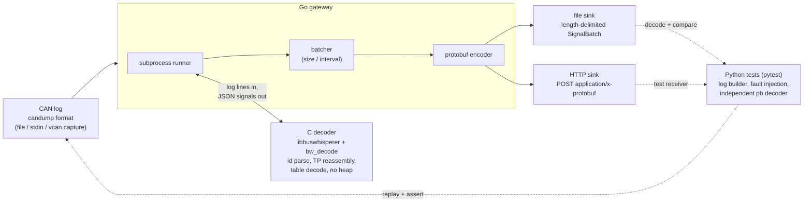

# BusWhisperer

**J1939 CAN decoder with a Go gateway and Python hardware-in-the-loop tests.**

> Built a fuzz-tested J1939 decoder in C with a Go/protobuf gateway and automated HIL-style test harness.

A zero-allocation C library that decodes J1939 truck CAN traffic from recorded logs, plus a Go gateway that ships the data as protobuf and a Python harness that tests the whole chain automatically. No CAN hardware is needed: everything runs from `candump`-format logs (with an optional SocketCAN `vcan0` test).

**Data:** only self-generated, synthetic logs are used (`data/sample.log`, produced by `scripts/gen_sample_log.py`, and logs built on the fly by the tests). No proprietary or third-party vehicle captures are included. Signal definitions follow the public SAE J1939-71 parameter layout.

## Features

- **C decoder library** (`c/`): parses 29-bit J1939 identifiers (priority, PGN, source/destination address) and decodes signals from a **table-driven** definition (see the table below). Adding a signal is one row in `c/src/signals.c` (compiled in; there is no runtime definition file).
- **Transport protocol**: BAM and RTS/CTS reassembly (passive observer), up to 1785 bytes, 4 concurrent sessions, 750 ms inter-packet timeout, sequence/size/packet-count validation, duplicate tolerance, abort handling, oldest-session eviction. No heap: all state is in a caller-owned `bw_ctx_t`.
- **Fuzzing + sanitizers**: a libFuzzer-compatible target, plus a coverage-guided driver that works with plain gcc. Everything runs under ASan + UBSan, with a gcov line-coverage report.
- **Go gateway** (`gateway/`): replays a candump log through the decoder, batches signals (by size and by time), and writes protobuf to a file or POSTs to an HTTP endpoint with retry/backoff.
- **Python HIL harness** (`harness/`): builds logs from physical values, injects malformed lines and TP faults, runs the real gateway, decodes the protobuf output with an independent decoder, and asserts end-to-end results. Includes an in-process HTTP receiver and an optional `vcan0` test.

## 60-second demo

```sh
make all            # ~10 s: builds the C decoder and Go gateway
make demo-live      # ~20 s: replays data/sample.log in real time, printing live decoded values
make demo           # ~1 s: same log through the gateway to build/demo.pb (protobuf)
make test-hil       # 44 end-to-end tests (a few seconds; first run also creates .venv)
```

`make demo-live` output (a synthetic drive: idle, pull away, cruise; `SPEED=4 make demo-live` plays 4x faster, `SPEED=0` unpaced):

```
[  4.50s] rpm   928.0 | speed   11.2 km/h | coolant   74 C | pedal  10.8 % | fuel   5.2 L/h
[  5.00s] rpm   997.8 | speed   15.2 km/h | coolant   75 C | pedal  12.8 % | fuel   5.2 L/h
[  5.28s] VIN received via BAM multi-packet: 1FUJGLDR12LM12345
[ 10.01s] rpm  1665.6 | speed   53.6 km/h | coolant   80 C | pedal  31.6 % | fuel  18.0 L/h
[ 14.51s] rpm  2125.1 | speed   80.0 km/h | coolant   84 C | pedal  44.8 % | fuel  34.0 L/h
decoder stats: {"lines":821,"parsed":818,...,"signals":1011,"tp_started":2,"tp_completed":1,"tp_errors":1,...}
```

The stats line shows the deliberately lossy second VIN transfer (a dropped packet) being rejected, plus the injected bad lines being skipped.

## Architecture



Plain-text version:

```
 CAN log ──► Go gateway ──stdin──► C decoder (bw_decode / libbuswhisperer)
 (candump)      │  ◄──── JSON lines ───┘  id parse → TP reassembly → table decode
                ▼
          batcher (size / interval) ─► protobuf ─┬─► file  (*.pb, length-delimited)
                                                 └─► HTTP  (POST, retry + backoff)
 Python/pytest: LogBuilder ─► gateway ─► output ─► independent pb decoder ─► asserts
```

| Path | Contents |
|---|---|
| `c/include/bw_j1939.h` | public API |
| `c/src/` | `id.c` (identifiers), `signals.c` (table + decode), `tp.c` (stream context, BAM/RTS), `candump.c` (log parser) |
| `c/tools/bw_decode.c` | CLI: candump in, JSON-lines signals out, `--stats` summary |
| `c/tests/test_bw.c` | unit tests (8284 checks) |
| `fuzz/`, `scripts/fuzz.sh` | fuzz target, gcc driver, coverage report |
| `proto/buswhisperer.proto` | wire schema |
| `gateway/` | Go module: `internal/{pb,decoder,batch,sink}`, `cmd/gateway` |
| `harness/` | Python package + pytest suites |
| `data/sample.log` | 20 s synthetic drive with a VIN over BAM and some bad lines |
| `scripts/` | `live_demo.py`, `gen_sample_log.py`, `fuzz.sh`, `vcan_setup.sh` |

## Decoded signals

| Signal | PGN | SPN | Bytes (start bit, length) | Resolution / offset | Unit |
|---|---|---|---|---|---|
| `engine_speed` | 61444 (EEC1) | 190 | 4-5 (24, 16) | 0.125 /bit | rpm |
| `engine_torque` | 61444 (EEC1) | 513 | 3 (16, 8) | 1 /bit, -125 | % |
| `accelerator_pedal` | 61443 (EEC2) | 91 | 2 (8, 8) | 0.4 /bit | % |
| `vehicle_speed` | 65265 (CCVS) | 84 | 2-3 (8, 16) | 1/256 /bit | km/h |
| `coolant_temp` | 65262 (ET1) | 110 | 1 (0, 8) | 1 /bit, -40 | degC |
| `fuel_rate` | 65266 (LFE) | 183 | 1-2 (0, 16) | 0.05 /bit | L/h |
| `vin` | 65260 (VI) | 237 | multi-packet ASCII, `*`-terminated | - | text |

Raw values in the J1939 error / not-available range (above `raw_max`: `0xFA` for 8-bit, `0xFAFF` for 16-bit) are dropped. Multi-packet messages arrive through TP.CM (PGN 60416) / TP.DT (PGN 60160).

## Fuzzing and sanitizer results

| Check | Result |
|---|---|
| C unit tests, plain build | 8284 checks, 0 failed |
| C unit tests, ASan + UBSan | 8284 checks, 0 failed, no sanitizer reports |
| Coverage-guided fuzzing, ASan + UBSan + leak check | 300,000 executions, 0 crashes, 0 sanitizer reports, 432 edges reached |
| Fuzz line coverage (gcov) | **98.78%** of 245 lines |

```
c/src/id.c             100.00% of 18 lines
c/src/signals.c        100.00% of 32 lines
c/src/tp.c              97.20% of 107 lines
c/src/candump.c        100.00% of 88 lines
TOTAL                   98.78% of 245 lines
```

Reproduce with `make test-san` and `make fuzz` (the run is deterministic for a given `FUZZ_SEED`; CI runs 500k iterations and uploads the coverage report). The fuzzer is a self-written gcc driver rather than libFuzzer or AFL++ (see design decisions); `make fuzz-libfuzzer` builds the real libFuzzer target if clang is available.

## Setup

Requirements: `gcc` + `make`, Go ≥ 1.22, Python ≥ 3.10 (pytest is installed into `.venv`). Docker is optional.

```sh
make all        # builds build/bw_decode and build/gateway
```

## Run

```sh
# decode a log directly
build/bw_decode --stats data/sample.log | head

# gateway -> protobuf file (configuration via env, see .env.example)
make demo                      # writes build/demo.pb, prints a summary
make demo-live                 # real-time replay with live decoded values
BW_LOG=data/sample.log BW_SINK=http BW_HTTP_URL=http://localhost:8080/ingest build/gateway

# whole stack in containers: gateway replays the sample log to an HTTP receiver
docker compose up --build
docker compose --profile test run --rm tests   # full test-suite in a container
```

Gateway variables (all optional, defaults shown in `.env.example`): `BW_DECODER`, `BW_LOG` (`-` = stdin), `BW_SINK` (`file`|`http`), `BW_OUT`, `BW_HTTP_URL`, `BW_HTTP_RETRIES`, `BW_BATCH_SIZE`, `BW_FLUSH_INTERVAL_MS`. No secrets are needed anywhere. The gateway prints a `summary {...}` JSON line (signals, batches, decoder counters) to stderr and exits non-zero if a batch could not be delivered.

Optional SocketCAN: `sudo scripts/vcan_setup.sh` creates `vcan0`; `test_vcan.py` then sends frames over it, captures them, and replays the capture. It is skipped when `vcan0` is absent.

## Test

```sh
make test       # everything below
make test-c     # C unit tests          make test-san  # same under ASan+UBSan
make test-go    # go vet + go test      make test-hil  # pytest end-to-end harness
make fuzz       # sanitized, coverage-guided fuzzing + gcov report (FUZZ_ITERS=300000 default)
```

Results from the last run on this repo: 8284 C checks pass (plain and ASan/UBSan); all Go tests pass; 44 pytest tests pass (1 skipped: vcan0 not present). 

Fuzzing and coverage numbers are in [Fuzzing and sanitizer results](#fuzzing-and-sanitizer-results).

## Key design decisions

- **Zero allocation, caller-owned state.** The library never calls `malloc`. The reassembly buffers live inside `bw_ctx_t` (~7 KB, 4 × 1785 bytes + bookkeeping), so it fits microcontrollers and is trivially fuzzable. Lengths are always passed explicitly; the line parser does not need NUL termination (the fuzz target feeds it exact-size heap copies so ASan catches any overread).
- **Table-driven signals with error ranges.** Each definition carries `raw_max`; values in the J1939 error/not-available ranges (e.g. `0xFB..` for 8-bit) are dropped instead of being reported as bogus numbers. Signals that do not fit in a short frame are skipped.
- **TP is a passive observer.** A logger sees both sides of a conversation, so RTS sessions are tracked without sending CTS. Any violation (bad size, packet count mismatch, gap/out-of-order sequence, wrong DA for BAM/RTS) drops that session and increments a counter; a repeated packet is tolerated. Time is taken from log timestamps, so replays are deterministic; a clock stepping backwards never causes a spurious timeout. Table full → the oldest session is evicted.
- **Gateway ↔ decoder via subprocess.** The Go service feeds the log to `bw_decode` over stdin and reads JSON lines. This keeps the C code free of cgo and lets the exact same binary be tested standalone, under sanitizers, and in the pipeline. The trade-off is JSON parsing overhead, which is irrelevant at CAN rates (a 1 Mbit bus is at most ~8k frames/s).
- **Protobuf without protoc.** `proto/buswhisperer.proto` is the contract, but the gateway uses a ~200-line hand-written codec (golden-byte tested, skips unknown fields, bounded sizes) so the project builds offline with zero Go dependencies. The Python harness decodes with a *separately written* decoder, so the end-to-end tests cross-check the wire format. If the schema grows, swap in `protoc`-generated code; the files/HTTP bodies stay compatible.
- **File format** is a stream of varint-length-delimited `SignalBatch` messages; HTTP sends one `SignalBatch` per POST. 5xx/network errors retry with exponential backoff; 4xx fail immediately. A failed batch does not abort the replay but makes the process exit 1.
- **Fuzzing without clang.** `fuzz/fuzz_target.c` exposes the standard `LLVMFuzzerTestOneInput` (`make fuzz-libfuzzer` if clang is installed). Because many machines only have gcc, `fuzz/standalone_driver.c` provides a self-contained mutational fuzzer that uses gcc's `-fsanitize-coverage=trace-pc` for edge feedback, saves crashing inputs, and works with gcov to report line coverage. It is less sophisticated than libFuzzer/AFL++ (no cmp-tracing or minimization) but finds the same class of bugs. It is how the figure above was produced. The harness also fuzzes bytes as raw text and as a binary frame stream.
- **Hostile-input handling in the CLI.** Lines are read byte-wise (embedded NULs, lines over 511 bytes and missing final newlines are handled and counted, never fatal). A fuzz-style pytest case found and now guards against an embedded-NUL line swallowing its successor.
- **Not covered / known limits.** Only extended (29-bit) classic CAN frames are decoded; 11-bit, RTR and CAN FD lines are counted and ignored. Only the PGNs in the table are decoded (no DM1 diagnostics, no SPN catalog). Docker files were written but could not be exercised in the authoring environment (snap-confined Docker could not read the project directory), so run `docker compose up --build` to confirm them on your machine.
